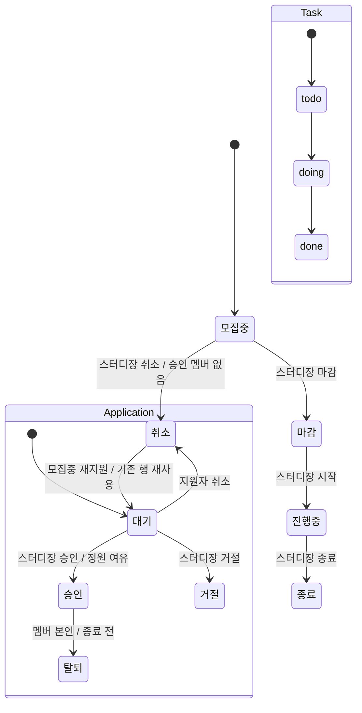
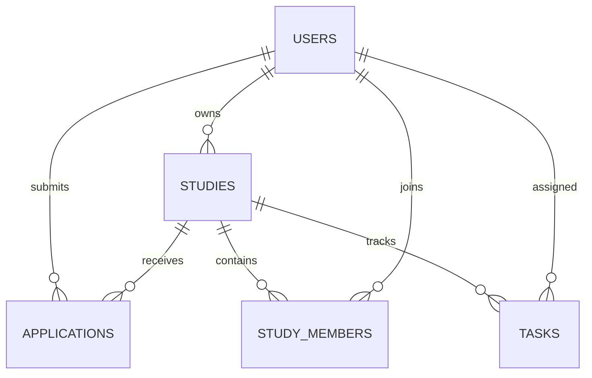

# StudyBoard 설계

## 범위

사용자는 스터디장과 일반 회원입니다. 관리 화면은 핵심 모집·참여 흐름의 범위를 유지하기 위해 생략합니다. 채팅, 알림, 외부 결제, 댓글, 차트는 구현 범위에서 제외합니다. 화면은 로그인/가입, 모집글 목록, 모집글 상세와 지원서 관리, 내 활동, 스터디 방의 5개입니다.

## 상태 전이

## 데이터 모델

`applications(study_id,user_id)`에는 UNIQUE 제약이 있어 사용자·스터디 조합마다 지원서 행은 하나만 둡니다. 대기·승인·거절 지원은 중복 생성할 수 없습니다. 지원자가 취소한 경우 모집 기간 안에 재지원하면 기존 행의 상태를 `PENDING`으로 되돌립니다. 정원은 `study_members` 수로 확인합니다. 스터디장은 승인 멤버와 별개이며 정원에 포함하지 않지만 스터디 방에 접근할 수 있습니다.

## 주체와 조건

| 행동 | 주체 | 서버 조건 |
| --- | --- | --- |
| 모집글 등록 | 로그인 회원 | 제목, 1 이상 정원, 유효한 마감일 |
| 지원 | 로그인 회원 | 본인 글 아님, 모집 중, 마감 전, 중복 없음 |
| 승인·거절 | 해당 스터디장 | 지원서 대기, 승인 시 최신 정원 여유 |
| 지원 취소 | 지원자 본인 | 지원서 대기, 스터디 모집중, 마감일 전 |
| 재지원 | 지원자 본인 | 기존 지원 상태 취소, 스터디 모집중, 마감일 전; 같은 지원서 행을 대기로 재사용 |
| 탈퇴 | 승인 멤버 본인 | 스터디가 종료·취소 전 |
| 작업 등록 | 해당 스터디 멤버 또는 소유자 | 종료·취소 전, 담당자는 스터디 참여자 |
| 작업 상태 변경 | 담당자 또는 스터디장 | `todo → doing → done` |
| 모집글 상태 변경 | 스터디장 | 상태도에 정의된 전이만 허용 |

## 일관성·삭제

제목은 100자 이하, 정원은 1~100명이며 마감일은 오늘 이후의 유효한 날짜여야 합니다. 작업 마감일은 입력 시 `YYYY-MM-DD` 달력 날짜 형식인지 검사합니다. 지원과 승인은 서버에서 모집 상태와 마감일을 검사합니다. 승인 가능한 상태는 모집중·마감이며 마감일이 지난 지원서는 승인할 수 없습니다. 시작은 마감 상태에서만 가능하고 승인 멤버가 한 명 이상이어야 합니다.

| 모집글 작업 | 허용 조건 | 처리 |
| --- | --- | --- |
| 삭제 | 지원서 행이 하나도 없고 승인 멤버도 없음 | 모집글 행 삭제 |
| 취소 | 모집중이며 승인 멤버 없음 | 한 트랜잭션에서 대기 지원서를 모두 거절 처리하고 모집글 취소 |
| 삭제·취소 불가 | 승인 멤버가 있음 | 데이터 보존; 멤버가 탈퇴할 수 있는 상태인지 먼저 확인 |
| 취소 불가 | 이미 모집중 상태가 아님 | 상태 전이 규칙으로 거절 |

삭제 조건은 “지원 이력이 전혀 없고 멤버도 없음”으로 통일합니다. 취소는 삭제와 별도 규칙이며 모집중·승인 멤버 없음 조건에서만 허용합니다. 지원서 취소와 거절 상태는 삭제하지 않습니다. 대기 지원서 일괄 거절과 모집글 취소는 한 트랜잭션에 묶습니다. 승인 트랜잭션은 대기 상태·최신 정원을 다시 확인하고 지원서 승인 및 멤버 추가를 함께 저장합니다. 승인·취소 중간 오류는 해당 변경 전체를 롤백합니다.

멤버 탈퇴도 트랜잭션으로 처리합니다. 지원 상태를 탈퇴로 바꾸고 멤버십을 제거하며 해당 멤버에게 배정된 작업의 `assignee_id`를 `NULL`로 바꿉니다. 작업 행은 유지하고 화면에는 “미배정”으로 표시합니다. 작업 `todo`는 삭제할 수 있고, `doing`·`done`은 `archived=1`로 보관합니다. 보관된 완료 작업도 진행률 분자에 포함합니다. 작업 0개일 때 진행률은 0%입니다.
