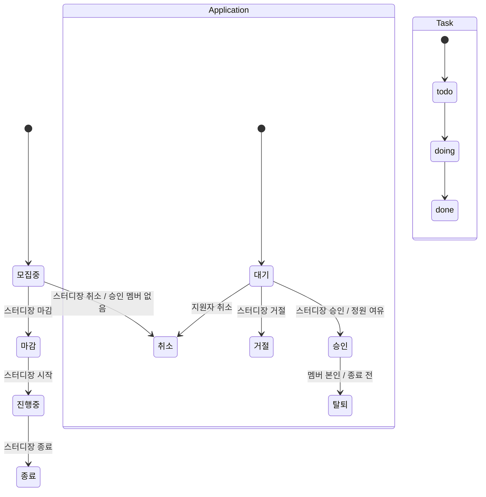
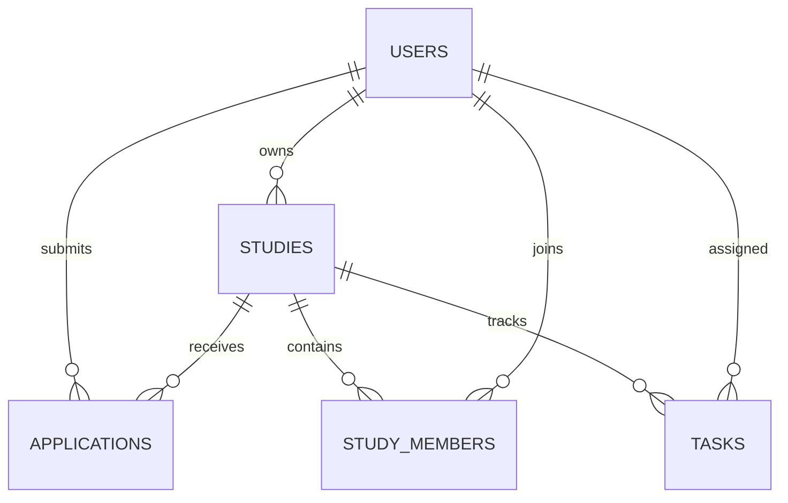

# StudyBoard 설계

## 범위

사용자는 스터디장과 일반 회원입니다. 관리 화면은 핵심 모집·참여 흐름의 범위를 유지하기 위해 생략합니다. 채팅, 알림, 외부 결제, 댓글, 차트는 구현 범위에서 제외합니다. 화면은 로그인/가입, 모집글 목록, 모집글 상세와 지원서 관리, 내 활동, 스터디 방의 5개입니다.

## 상태 전이

## 데이터 모델

`applications(study_id,user_id)`에는 UNIQUE 제약이 있어 취소·거절 이후에도 같은 계정의 재지원을 막고 이력을 보존합니다. 정원은 `study_members` 수로 확인합니다. 스터디장은 소유자로 작업 공간 권한을 가지며, 모집 정원 계산에는 포함하지 않습니다.

## 주체와 조건

| 행동 | 주체 | 서버 조건 |
| --- | --- | --- |
| 모집글 등록 | 로그인 회원 | 제목, 1 이상 정원, 유효한 마감일 |
| 지원 | 로그인 회원 | 본인 글 아님, 모집 중, 마감 전, 중복 없음 |
| 승인·거절 | 해당 스터디장 | 지원서 대기, 승인 시 최신 정원 여유 |
| 지원 취소 | 지원자 본인 | 지원서 대기 |
| 탈퇴 | 승인 멤버 본인 | 스터디가 종료·취소 전 |
| 작업 등록 | 해당 스터디 멤버 또는 소유자 | 종료·취소 전, 담당자는 스터디 참여자 |
| 작업 상태 변경 | 담당자 또는 스터디장 | `todo → doing → done` |
| 모집글 상태 변경 | 스터디장 | 상태도에 정의된 전이만 허용 |

## 일관성·삭제

승인은 `BEGIN IMMEDIATE` 이후 대기 상태와 멤버 정원을 다시 읽고, 지원서 승인과 멤버 추가를 같은 트랜잭션에 넣습니다. 중간 오류는 두 변경을 모두 롤백합니다. 취소·거절된 지원서는 삭제하지 않습니다. 작업 `todo`는 삭제할 수 있고, `doing`·`done`은 `archived=1`로 보관합니다. 보관된 완료 작업도 진행률 분자에 포함합니다. 작업 0개일 때 진행률은 0%입니다.
