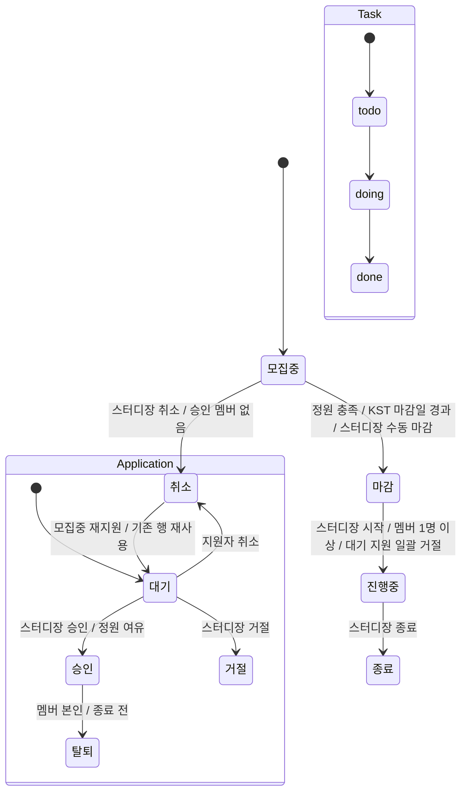
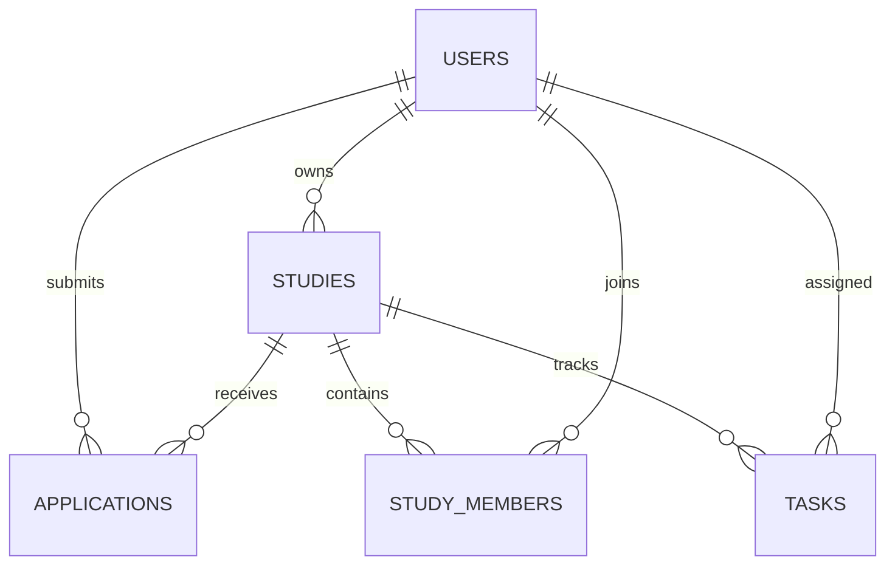

# StudyBoard 설계

## 범위

사용자는 스터디장과 일반 회원입니다. 관리 화면은 핵심 모집·참여 흐름의 범위를 유지하기 위해 생략합니다. 채팅, 알림, 외부 결제, 댓글, 차트는 구현 범위에서 제외합니다. 화면은 로그인/가입, 모집글 목록, 모집글 상세와 지원서 관리, 내 활동, 스터디 방의 5개입니다.

## 상태 전이

## 데이터 모델

`applications`에는 지원 메시지(`message`), 제출 시각(`created_at`), 처리자(`decided_by`), 처리 시각(`decided_at`)을 보관합니다. 지원 이력은 스터디장에게만 공개하고 목록·상세 모집글은 비로그인 사용자도 볼 수 있습니다. `applications(study_id,user_id)`에는 UNIQUE 제약이 있어 사용자·스터디 조합마다 지원서 행은 하나만 둡니다. 대기·승인·거절 지원은 중복 생성할 수 없습니다. 지원자가 취소한 경우 모집 기간 안에 재지원하면 기존 행의 상태를 `PENDING`으로 되돌립니다. 정원은 `study_members` 수로 확인합니다. 스터디장은 승인 멤버와 별개이며 정원에 포함하지 않지만 스터디 방에 접근할 수 있습니다.

## 주체와 조건

| 행동 | 주체 | 서버 조건 |
| --- | --- | --- |
| 모집글 등록 | 로그인 회원 | 제목, 1 이상 정원, 유효한 마감일 |
| 모집글 수정 | 해당 스터디장 | 모집중 상태, 제목·소개·정원·마감일 유효, 정원 ≥ 승인 멤버 수 |
| 지원 | 로그인 회원 | 본인 글 아님, 모집 중, 마감 전, 중복 없음, 지원 메시지 500자 이하 |
| 승인·거절 | 해당 스터디장 | 지원서 대기; 승인은 모집중·KST 마감일 전·최신 정원 여유 |
| 지원 취소 | 지원자 본인 | 지원서 대기, 스터디 모집중, 마감일 전 |
| 재지원 | 지원자 본인 | 기존 지원 상태 취소, 스터디 모집중, 마감일 전; 같은 지원서 행을 대기로 재사용 |
| 탈퇴 | 승인 멤버 본인 | 스터디가 종료·취소 전 |
| 작업 등록 | 해당 스터디 멤버 또는 소유자 | 스터디가 진행 중(`ACTIVE`), 회원은 본인 담당만 지정, 스터디장은 참여자 지정 가능 |
| 작업 상태 변경 | 담당자 또는 스터디장 | 스터디가 진행 중(`ACTIVE`), `todo → doing → done` |
| 모집글 상태 변경 | 스터디장 | 상태도에 정의된 전이만 허용 |

모집글 수정은 `PATCH /api/studies/:id`로 처리합니다. 서비스 계층에서 존재 여부와 스터디 소유권, 모집중 상태, 전체 입력값, 현재 멤버 수를 순서대로 확인합니다. 실패 시 UPDATE 전 거절하므로 저장된 필드는 바뀌지 않습니다.

`close_reason`은 `FULL`(정원 충족), `DEADLINE`(기간 만료), `MANUAL`(스터디장 조기 마감)으로 저장합니다. 정원 충족은 승인 처리와 같은 `BEGIN IMMEDIATE` 트랜잭션에서 `CLOSED/FULL`로 바꿉니다. 마감일은 `Asia/Seoul` 날짜 기준으로 처리하며 마감일 23:59:59까지 유효하고, 다음 KST 날짜가 시작된 후 목록·상세 조회와 지원·승인 요청에서 `CLOSED/DEADLINE`으로 갱신합니다. 따라서 스케줄러 없이도 다음 요청에서 상태가 맞춰집니다. 승인된 멤버가 탈퇴해도 모집은 자동 재개하지 않습니다. 마감 이후 대기 지원은 시작 전까지 남아 있고 승인할 수 없으며, 스터디장이 시작할 때 대기 건을 `REJECTED`로 일괄 변경합니다.

## 일관성·삭제

모집글 제목은 100자·UTF-8 300바이트 이하, 정원은 1~100명이며 마감일은 오늘 또는 이후의 유효한 날짜여야 합니다. 마감일 비교는 KST 기준입니다. 아이디는 ASCII 영문·숫자·밑줄 3~30자입니다. 비밀번호는 8자 이상·UTF-8 72바이트 이하이고, 아이디와 같은 값 또는 자주 쓰이는 비밀번호는 거절합니다. bcrypt가 72바이트 이후를 무시하는 특성이 있으므로 서버는 바이트 수를 검사해 긴 값을 거절합니다. 대문자·숫자·기호 조합을 강제하지 않습니다. 작업 제목은 최대 120자·UTF-8 360바이트, 설명은 1000자, 작업 마감일은 `YYYY-MM-DD` 유효 날짜입니다. 승인 가능한 상태는 `RECRUITING`만이며 마감일이 지난 지원은 `DEADLINE`으로 닫힌 뒤 거절됩니다. 스터디장은 정원에 포함하지 않고 승인된 멤버만 정원에 계산합니다. 시작은 마감 상태에서만 가능하고 승인 멤버가 한 명 이상이어야 합니다.

| 모집글 작업 | 허용 조건 | 처리 |
| --- | --- | --- |
| 삭제 | 지원서 행이 하나도 없고 승인 멤버도 없음 | 모집글 행 삭제 |
| 취소 | 모집중이며 승인 멤버 없음 | 한 트랜잭션에서 대기 지원서를 모두 거절 처리하고 모집글 취소 |
| 삭제·취소 불가 | 승인 멤버가 있음 | 데이터 보존; 멤버가 탈퇴할 수 있는 상태인지 먼저 확인 |
| 취소 불가 | 이미 모집중 상태가 아님 | 상태 전이 규칙으로 거절 |

삭제 조건은 “지원 이력이 전혀 없고 멤버도 없음”으로 통일합니다. 취소는 삭제와 별도 규칙이며 모집중·승인 멤버 없음 조건에서만 허용합니다. 지원서 취소와 거절 상태는 삭제하지 않습니다. 대기 지원서 일괄 거절과 모집글 취소는 한 트랜잭션에 묶습니다. 승인 트랜잭션은 대기 상태·최신 정원을 다시 확인하고 지원서 승인 및 멤버 추가를 함께 저장합니다. 승인·취소 중간 오류는 해당 변경 전체를 롤백합니다.

스터디 방은 스터디장과 승인된 멤버만 조회할 수 있습니다. 참여자 API는 스터디장/멤버 역할과 담당 중인 보관되지 않은 작업 수를 반환합니다. 작업은 3열 todo/doing/done 보드로 표시하고, 0개일 때 빈 안내와 등록 폼을 보여 줍니다. 생성·상태 변경·삭제·보관은 스터디가 `ACTIVE`일 때만 허용하고, 종료·취소·모집 마감 상태는 읽기 전용입니다. 멤버는 새 작업의 담당자를 본인으로만 지정할 수 있고, 스터디장은 참여자를 담당자로 고를 수 있습니다.

멤버 탈퇴도 트랜잭션으로 처리합니다. 지원 상태를 탈퇴로 바꾸고 멤버십을 제거하며 해당 멤버에게 배정된 작업의 `assignee_id`를 `NULL`로 바꿉니다. 작업 행은 유지하고 화면에는 “미배정”으로 표시합니다. 모집이 정원 때문에 마감된 뒤 멤버가 탈퇴해도 자동으로 재개하지 않습니다. 작업 `todo`는 삭제할 수 있고, `doing`·`done`은 `archived=1`로 보관합니다. 보관된 완료 작업도 진행률 분자에 포함합니다. 작업 0개일 때 진행률은 0%입니다.
