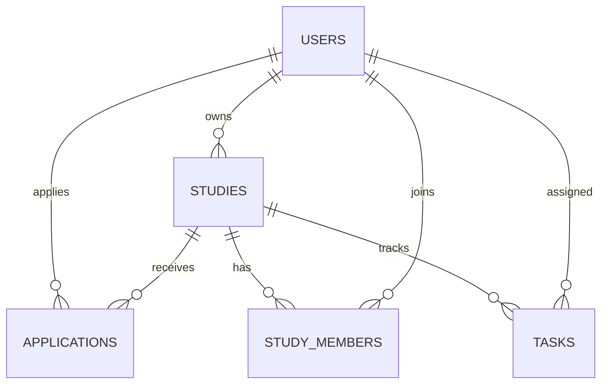

# StudyBoard 자유주제 Term Project 보고서

| 항목 | 내용 |
| --- | --- |
| 학번·이름 | 202323035 · 홍나린 |
| 분반 | 웹서비스설계 한국어 분반 |
| 저장소 | https://github.com/skfls0721/study-recruitment-management |
| 코드 기준 | `c30e2cf68bd1d82efb1da4d89bbfdbad220dae46` (2026-11-19 기준; 보고서 수정본은 별도 커밋) |
| 배포 | http://s.jedutools.io:40141 |
| 실행 환경 | JCloud Ubuntu 24.04, Node.js 24.x, systemd `studyboard.service` |

## 01 서비스 소개와 범위

### 서비스 정의와 해결할 문제

StudyBoard는 **스터디장이 모집글을 올리고 회원이 지원하면, 스터디장이 정원과 조건을 확인해 승인·거절하고, 승인된 멤버가 스터디 방에서 작업을 관리하며 스터디장이 스터디를 종료하는 서비스**입니다. 단체 채팅방이나 온라인 폼만으로 모집할 때는 정원을 넘겨 승인하거나 같은 사람의 지원이 겹치고, 지원서를 놓치는 문제가 생길 수 있습니다. StudyBoard는 서버가 소유권, 지원 상태, 정원, 모집 마감일을 다시 확인하고 SQLite 제약과 트랜잭션으로 잘못된 변경을 막습니다.

### 사용자와 권한 범위

| 사용자 | 식별 기준 | 가능한 행동 |
| --- | --- | --- |
| 비로그인 방문자 | 인증 토큰 없음 | 모집글 목록·상세 조회, 가입·로그인 |
| 회원·지원자 | 유효한 JWT의 사용자 ID | 모집글 작성, 다른 사람 글 지원, 본인 대기 지원 취소, 본인 활동 조회 |
| 스터디장 | `studies.owner_id`가 로그인 사용자 ID와 일치 | 본인 글 수정·삭제·상태 변경, 지원서 승인·거절, 스터디 방 접근 |
| 승인 멤버 | `(study_id,user_id)`가 `study_members`에 존재 | 스터디 방·멤버·작업 조회, 작업 등록, 담당 작업 진행, 탈퇴 |

스터디장은 정원 계산에서 제외하지만 소유한 스터디 방에는 접근할 수 있습니다. 별도 관리자 역할과 관리 화면은 핵심 흐름의 범위를 유지하기 위해 생략했습니다.

### 화면과 기능 범위

| 화면 | 제공 기능 |
| --- | --- |
| 로그인·가입 | username 기반 가입·로그인, 오류 표시 |
| 모집글 목록 | 검색·정렬, 모집 상태·정원·마감일 요약 |
| 모집글 상세 | 모집글 조회, 지원·취소·재지원, 소유자용 수정·삭제·상태 전환, 지원서 관리 |
| 내 활동 | 본인 지원 상태, 지원 취소·재지원, 참여 스터디 바로가기 |
| 스터디 방 | 멤버 목록, 작업 보드, 순방향 상태 변경, 진행률 |

필수 흐름은 가입 또는 로그인 → 모집글 등록·조회 → 다른 계정 지원 → 스터디장 승인 → 승인 멤버가 작업 생성·진행 → 진행률 확인 → 스터디장 종료입니다. 채팅, 알림, 외부 결제, 댓글, 차트, 별도 관리자 화면은 구현하지 않았습니다. 화면은 별도 빌드 없이 정적 HTML/CSS/JavaScript로 제공하며 API는 같은 배포 호스트의 `/api` 경로를 사용합니다.

## 02 설계

### 데이터 모델과 관계

| 테이블 | 주요 데이터 | 무결성 조건 |
| --- | --- | --- |
| `users` | 사용자 ID, username, 표시 이름, 비밀번호 해시 | username UNIQUE, 해시만 저장 |
| `studies` | 소유자, 제목, 소개, 정원, 마감일, 상태 | 소유자 외래키, 정원 CHECK(1 이상), 상태 CHECK |
| `applications` | 스터디·지원자, 상태, 생성·수정 시각 | `UNIQUE(study_id,user_id)`, 상태 CHECK |
| `study_members` | 스터디·멤버, 가입 시각 | `PRIMARY KEY(study_id,user_id)` 중복 멤버 방지 |
| `tasks` | 스터디, 제목, 담당자, 상태, 마감일, 보관 여부 | 외래키, 상태·보관 값 CHECK |

정원은 별도 카운터를 저장하지 않고 `study_members`의 현재 행 수로 확인합니다. 승인과 정원 확인을 같은 쓰기 트랜잭션에서 처리하므로 승인 수 카운터와 멤버 행이 어긋날 가능성을 줄입니다. 지원서 행은 중복 신청을 막고 취소·거절·탈퇴 이력을 남깁니다.

### 핵심 상태 전이

**모집글**: `RECRUITING(모집중) → CLOSED(마감) → ACTIVE(진행중) → FINISHED(종료)`. 모집중에서 승인 멤버가 한 명도 없을 때만 `CANCELLED(취소)`로 이동할 수 있습니다. 마감에서 모집중으로 되돌리는 전이는 없습니다. 종료·취소는 종단 상태입니다.

**지원서**: `PENDING(대기) → APPROVED(승인) → WITHDRAWN(탈퇴)`, `PENDING → REJECTED(거절)`, `PENDING → CANCELLED(지원 취소)`. 지원자가 취소한 행은 모집 중·마감일 전 재지원 시 동일 행을 `PENDING`으로 재사용합니다. 거절·승인·탈퇴 이력에서 재지원은 허용하지 않습니다.

**작업**: `todo → doing → done`. 역방향 및 건너뛰기는 거절합니다. `todo`는 삭제할 수 있고 `doing`·`done`은 `archived=1`로 보관하며, 보관된 `done`도 진행률에 포함합니다.

### 행동 주체와 허용 조건

| 행동 | 실행 주체 | 서버 허용 조건 | 거절 예 |
| --- | --- | --- | --- |
| 모집글 등록 | 로그인 회원 | 제목 1~100자, 소개 1000자 이하, 정원 1~100 정수, 유효한 오늘 이후 마감일 | 입력 오류 400 |
| 모집글 수정 | 해당 스터디장 | 모집중 상태, 입력값 유효, 정원 ≥ 승인 멤버 수 | 권한 403, 상태·정원 충돌 409 |
| 지원 | 로그인 회원 | 본인 글 아님, 모집중, 마감일 전, 중복 아님 | 본인 글 403, 상태·중복 409 |
| 승인 | 해당 스터디장 | 대기 지원서, 모집중·마감, 마감일 전, 현재 정원 여유 | 권한 403, 상태·정원 409 |
| 거절 | 해당 스터디장 | 대기 지원서 | 권한 403, 상태 409 |
| 지원 취소 | 지원자 본인 | 대기 상태, 모집중, 마감일 전 | 타인 403, 상태 409 |
| 스터디 시작 | 해당 스터디장 | 마감 상태이고 승인 멤버가 1명 이상 | 상태·조건 409 |
| 스터디 취소 | 해당 스터디장 | 모집중이고 승인 멤버가 없음 | 상태·조건 409 |
| 작업 등록·조회 | 스터디장 또는 승인 멤버 | 해당 스터디 소속, 종료·취소 아님 | 비멤버 403, 종단 상태 409 |
| 작업 상태 변경 | 담당자 또는 스터디장 | 같은 스터디 작업, 허용된 다음 상태 | 타인 403, 전이 오류 409 |
| 멤버 탈퇴 | 승인 멤버 본인 | 해당 지원서 승인, 스터디 종료·취소 전 | 타인 403, 상태 409 |

### API 요약

모든 보호 API는 `Authorization: Bearer <JWT>`를 확인합니다. 오류 본문은 `{code,message}`이며 입력 400, 인증 401, 권한 403, 대상 없음 404, 상태·중복 충돌 409로 구분합니다.

| Method / 경로 | 인증·권한 | 핵심 조건 및 실패 |
| --- | --- | --- |
| `POST /api/auth/signup`, `POST /api/auth/login` | 공개 | 가입값 검증·username 중복(400/409), 로그인 실패(401) |
| `GET /api/studies`, `GET /api/studies/:id` | 공개 | 검색·정렬 또는 존재 여부(400/404) |
| `POST /api/studies` | 로그인 회원 | 모집글 입력 검사(400) |
| `PATCH /api/studies/:id` | 스터디장 | 모집중만, 정원 축소 하한 확인(403/404/409) |
| `PATCH /api/studies/:id/status` | 스터디장 | 정의된 상태 전이·시작/취소 조건(403/404/409) |
| `DELETE /api/studies/:id` | 스터디장 | 지원서와 멤버 이력 모두 없을 때만(403/404/409) |
| `POST /api/studies/:id/applications` | 로그인 회원 | 본인 글 제외, 모집 상태·마감일·중복 확인(400/403/404/409) |
| `GET /api/studies/:id/applications` | 해당 스터디장 | 소유권 확인(403/404) |
| `PATCH /api/applications/:id/approve`, `/reject` | 해당 스터디장 | PENDING만, 승인 시 정원·마감 재검사(403/404/409) |
| `PATCH /api/applications/:id/cancel` | 지원자 본인 | 본인 PENDING 지원서만(403/404/409) |
| `GET /api/me/applications`, `GET /api/me/studies` | 본인 | JWT 사용자 ID만 조회(401) |
| `PATCH /api/studies/:id/leave` | 승인 멤버 본인 | 종료 전 탈퇴 및 배정 작업 담당자 해제(403/404/409) |
| `GET /api/studies/:id/members`, `/tasks`, `/progress` | 스터디장·승인 멤버 | 스터디 소속 확인(401/403/404) |
| `POST /api/studies/:id/tasks` | 스터디장·승인 멤버 | 종료·취소 전, 제목·담당자·날짜 유효(400/403/404/409) |
| `PATCH /api/tasks/:id/status` | 담당자·스터디장 | 같은 스터디의 작업, 순방향, 종료 전(403/404/409) |
| `DELETE /api/tasks/:id` | 스터디장·승인 멤버 | `todo` 삭제, 그 외 보관(403/404) |

### 삭제와 이력 보존

| 대상 | 조건 | 처리 이유 |
| --- | --- | --- |
| 모집글 | 지원서 행과 승인 멤버가 모두 없음 | 참조 이력이 없어 실제 삭제 가능 |
| 모집글 취소 | 모집중이며 승인 멤버 없음 | 대기 지원서를 거절하고 모집글을 취소 처리해 지원 기록 보존 |
| 모집글 삭제 요청 | 지원 이력 또는 멤버 존재 | 409로 거절하고 행·이력 보존 |
| 지원서 | 모든 상태 | 행 삭제 대신 취소·거절·탈퇴 상태로 이력 보존 |
| 작업 | `todo` | 실제 삭제 허용 |
| 작업 | `doing` 또는 `done` | `archived` 처리, 진행 이력과 완료율 계산을 위해 보존 |

## 03 구현과 설계 결정

### 기술과 계층

| 계층 | 기술·파일 | 역할 |
| --- | --- | --- |
| 화면 | HTML/CSS/JavaScript, `client/app.js` | 입력·상태 안내·렌더링, 상대 API 호출 `/api/...` |
| HTTP | Express 5, `server/app.js` | 라우트, 인증 미들웨어 연결, 응답·오류 전달 |
| 인증 | `server/auth.js` | bcryptjs cost 12 해시, HS256 JWT(2시간), 발급·검증 |
| 업무 규칙 | `server/services/study-service.js` | 소유권·멤버십·정원·상태 전이·트랜잭션 |
| SQL 저장소 | `server/repositories/study-repository.js` | 파라미터 바인딩 SQL, 조회·집계 |
| 데이터베이스 | Node `node:sqlite`, `server/db/schema.js` | SQLite 스키마·CHECK·UNIQUE·외래키·마이그레이션 |
| 자동 검증 | Vitest, Supertest, `tests/studyboard.test.js` | HTTP 수준 규칙·권한·상태·롤백 검증 |

서버 검사 흐름은 인증 → 대상 조회 → 소유권·멤버십 검사 → 입력·상태·정원 검사 → 저장입니다. 주요 업무 규칙은 화면 버튼 표시만으로 보호하지 않고 서비스 계층에서 다시 검사합니다. DB 값에는 준비된 SQL과 파라미터 바인딩을 사용하며 화면에는 사용자 입력을 escape한 뒤 표시합니다.

### 주요 일관성 처리

`study-service.js`의 `tx`는 `BEGIN IMMEDIATE`로 쓰기 트랜잭션을 시작하고 성공 시 COMMIT, 예외 시 ROLLBACK합니다. 승인 흐름은 지원서가 PENDING인지, 소유자가 맞는지, 스터디 상태·마감일이 허용되는지, 현재 멤버 수가 정원 미만인지 재검사한 뒤 지원서를 승인하고 `study_members`에 추가합니다. 중간 INSERT 오류 주입 테스트에서 지원서 상태까지 원복되는 것을 확인했습니다. 모집 취소도 대기 지원서 REJECTED 변경과 스터디 CANCELLED 변경을 한 트랜잭션으로 처리합니다. 탈퇴는 지원서 WITHDRAWN, 담당 작업의 assignee NULL, 멤버십 제거를 함께 저장합니다.

### 기존 과제 참고와 신규 구현 구분

다른 과제 저장소는 읽기와 구조 참고만 했으며 수정·커밋·푸시하지 않았습니다. 상세 파일 경로·저장소 URL·확인한 커밋은 `docs/usage-log.md`에 기록했습니다.

| 구분 | 참고한 부분 | 이번 프로젝트에서 새로 작성한 부분 |
| --- | --- | --- |
| 웹서비스설계 과제 2 | 서비스·저장소 계층 분리, JWT 인증, 오류 응답, SQLite 트랜잭션의 구조 | StudyBoard 도메인과 소유권, 정원 재검사, 지원·승인·취소·탈퇴·작업 업무 규칙 |
| 9주차 게시판 페이지네이션 | 검색·정렬 입력 방어와 허용 목록 개념 | 스터디 검색과 정렬 화이트리스트 |
| `wsd`, `jwt-board-hanip-review` | 코드 복사 없음 | 구현 코드 신규 작성 |

기존 게시판 CRUD의 이름이나 화면만 바꾸지 않았습니다. 모집 상태 전이, 정원 제약, 스터디장 소유권, 멤버십, 지원 이력, 승인 트랜잭션, 작업 상태 전이는 별도 도메인 규칙으로 설계하고 테스트했습니다.

### 해결한 오류와 선택하지 않은 확장

화면에서 생성한 뒤 폼을 초기화하는 과정에 이미 분리된 폼 노드를 참조해 `currentTarget.reset` 오류가 발생한 적이 있었습니다. 이벤트에서 폼 참조를 먼저 보관하고 처리하도록 고쳐 등록 후 목록을 다시 불러오게 했습니다. 브라우저 뒤로가기로 앱 창을 벗어나는 문제는 History API 상태와 `popstate` 렌더링을 연결해 보완했습니다. 정원이 찬 뒤에도 모집글은 자동 마감하지 않는 정책을 택했습니다. 대신 승인 시 서버가 정원을 재확인하고 화면에서 승인 불가 안내를 표시합니다.

## 04 검증 결과

### 자동 테스트

2026-11-20 로컬 프로젝트에서 `npm test`를 실행해 Vitest 5.1.0 + Supertest **30개 테스트 전부 통과**를 확인했습니다. `npm audit --omit=dev`는 취약점 0건입니다. 전체 개발 의존성 감사는 개발 도구 경로의 `picomatch` 권고를 별도로 보고하며 런타임 의존성에는 포함되지 않습니다.

| 준비 상태 | 수행 동작 | 예상 결과 | 실제 결과 |
| --- | --- | --- | --- |
| 신규 사용자, 빈 보호 데이터 | 가입·로그인 후 토큰 없이 보호 API 호출 | 로그인 성공, 보호 API 401, 데이터 불변 | 통과: 30개 테스트 묶음 |
| 가입된 사용자와 변조 토큰 | 중복 가입·위조 토큰 요청, 사용자 응답·DB 해시 확인 | 중복 409, 변조 401, bcrypt 해시만 저장 | 통과 |
| 다른 사용자의 ID를 본문에 삽입 | 모집글 생성 후 상세·진행률 없는 ID 요청 | 소유자는 토큰에서 결정, 없는 대상 404 | 통과 |
| 손상된 JSON 본문 | 잘못된 JSON API 요청 | 400 JSON 오류 안내 | 통과 |
| 16KB를 넘는 요청 본문 | 본문 크기 제한을 넘겨 요청 | 413 JSON 오류 | 통과 |
| 타인 소유 스터디와 다른 회원 | 본인 글 지원, 중복 지원, 타인 승인, 비멤버 작업 등록 | 403/409, 기존 데이터 불변 | 통과 |
| 정원 한 자리와 대기 지원자 | 한 건 승인 후 추가 승인 | 첫 건 멤버 추가, 초과분 409 | 통과 |
| todo·doing·done 작업 | 순방향 변경, 역행·건너뛰기, 진행률 계산 | 순방향만 허용, 완료율 일치 | 통과 |
| 작업 0개 및 마감 모집글 | 진행률 요청, 마감 글 지원 | 0%, 지원 409 | 통과 |
| 취소한 대기 지원 | 취소 후 모집 기간에 재지원 | 동일 지원 행을 다시 PENDING으로 사용 | 통과 |
| todo·doing·done 작업 | todo 삭제, 진행 중·완료 작업 보관 | todo 삭제, 나머지는 보관, 보관 done 포함 | 통과 |
| 소유자·멤버·비멤버 계정 | 정원에서 소유자 제외, 내 활동·멤버 API 요청 | 정원 계산 및 접근 권한 일치 | 통과 |
| 승인 멤버와 배정 작업 | 멤버 탈퇴 | WITHDRAWN, 작업 담당자 NULL, 멤버십 제거 | 통과 |
| 승인 중 멤버 INSERT 오류 | 강제 DB 오류 후 상태 재조회 | 지원서와 멤버 추가 모두 롤백 | 통과 |
| 정원 마지막 한 자리와 승인 2건 | `Promise.all`로 두 승인 요청 | 한 건만 반영, 정원 초과 없음 | 통과 |
| 이미 승인된 지원서 | 동일 승인 API 연속 2회 | 첫 승인만 처리, 두 번째 409, 멤버 중복 없음 | 통과 |
| 대기 지원서가 있는 모집중 글 | 스터디 취소 | 대기 지원서 REJECTED, 모집글 CANCELLED | 통과 |
| 취소 시 거절 처리 강제 실패 | 오류를 주입하고 스터디·지원서 조회 | 양쪽 변경 모두 롤백 | 통과 |
| 승인 멤버 없는 마감 글 / 멤버 있는 마감 글 | 시작 조건 실패 및 정상 시작 | 실패 409, 조건 만족 시 ACTIVE | 통과 |
| 모집중·진행중·종료·취소 스터디 | 승인과 마감일 조건 조합 | 허용 상태만 승인, 종료 상태·만료일 409 | 통과 |
| 과거 마감일·정원 상한 초과·긴 제목 | 모집글 등록 요청 | 입력 400, 행 미생성 | 통과 |
| 모집중 글·스터디장과 타인 | 정상 수정, 타인·마감 글·정원 하향·오입력 수정 | 정상 저장, 거절 시 기존 필드 불변 | 통과 |
| 모집중·마감·진행중 스터디 | 마감→시작→종료, 전이 순서 위반, 종료 후 변경 | 정의된 전이만 반영, 불가 전이 409 | 통과 |
| 승인 멤버가 있는 모집중 글 | 취소 요청 후 모집글·지원서·멤버 조회 | 409, 세 데이터 모두 불변 | 통과 |
| 지원 이력 있는 글과 없는 글 | 각각 삭제 요청 | 이력 있는 글 409 보존, 빈 글 삭제 | 통과 |
| 거절·타인 취소·승인 지원서 | 재승인·재지원·타인 취소·승인 후 취소 | 정책에 따라 403/409, 상태 불변 | 통과 |
| 만료 모집글·타 스터디 작업·비멤버 | 지원·작업·멤버 조회 | 409/403, 관련 데이터 불변 | 통과 |
| 이미 탈퇴한 사용자 | 재탈퇴 요청 | 409, WITHDRAWN 이력 유지 | 통과 |
| 잘못된 등록 입력 | 빈 제목·잘못된 정원·긴 소개·잘못된 날짜 | 400, 모집글 저장 안 됨 | 통과 |

이 표의 30행은 테스트 파일의 30개 테스트를 준비 상황과 수행 묶음에 따라 표시합니다. 세부 단언과 실행 명령은 `tests/studyboard.test.js` 및 `docs/verification.md`에 있습니다. 거절 시 DB 상태를 다시 읽어 기존 데이터가 유지되는지도 검증했습니다.

동시 승인 테스트는 `Promise.all`로 두 요청을 보냈지만 `node:sqlite`의 동기식 호출 특성상 독립 프로세스 간 실제 경합을 재현하지 않습니다. 본 테스트는 한 자리에서 승인 행과 멤버 행이 하나만 생기는 것을 확인한 것이며, 다중 프로세스 부하 테스트는 하지 않았습니다.

### 화면·배포 검증

| 검증 항목 | 수행 내용 | 결과와 남은 점 |
| --- | --- | --- |
| JCloud 서버 상태 | systemd `studyboard.service` 활성화, 내부 `/api/health` 요청 | `{"status":"ok"}` 확인, DB 파일은 프로젝트의 `data/studyboard.sqlite` 경로 사용 |
| 배포 API 설정 | 프런트 소스의 API 호출 경로 확인 | 상대 경로 `/api/...`, localhost 하드코딩 없음 |
| 브라우저 화면 폭 | 배포 사이트를 390px 폭으로 모의 확인 | 로그인·목록 표시, 비로그인 모집 폼 숨김, 가로 넘침·Console 오류 없음 |
| 실제 모바일 데이터망 | 휴대폰 Wi-Fi를 끄고 로그인부터 승인까지 확인 | 사용자 현장 확인 및 캡처가 필요함 |
| 역할별 배포 전체 흐름 | leaderA/memberC 계정으로 등록·지원·승인·작업 | 최신 화면 캡처와 증거 추가 필요 |
| Network 탭 | 배포 API 주소와 응답 확인 | 요청 URL·상태 코드 캡처 추가 필요. 토큰 원문은 증거로 남기지 않음 |

화면 캡처는 보고서 제출 전에 로그인·목록, 상세·지원 상태, 지원자 관리·정원 안내, 작업·진행률, Network API 확인 화면으로 추가합니다. 실제 모바일 네트워크 검증은 390px 화면 크기 모의와 구분해 기록합니다.

### 알려진 제한사항과 미구현 범위

1. 정원이 차도 모집 상태는 자동 마감되지 않습니다. 대기 지원서는 유지하며 승인 시 최신 정원을 다시 검사합니다.
2. 모집글 정원 허용 범위는 1~100명이며, 회원 식별자는 이메일이 아니라 username입니다.
3. 거절된 지원서는 재지원할 수 없습니다. 본인이 취소한 대기 지원만 기존 행을 재사용해 재지원할 수 있습니다.
4. 로그인 반복 시도 제한, 카테고리 필터, 별도 관리자 화면은 구현하지 않았습니다.
5. 스터디장 멤버 강퇴, 모집 마감 후 재오픈은 구현하지 않았습니다.
6. `Promise.all` 테스트는 다중 프로세스 동시성 검증이 아닙니다.
7. 전체 `npm audit`의 개발 의존성 경로에서 `picomatch` 권고가 보고됩니다. `npm audit --omit=dev`는 0건입니다.
8. 휴대폰 데이터망 전체 사용 흐름 및 Network 탭의 실제 캡처는 사용자가 확인해 제공해야 합니다.

## 05 기여와 자료 활용

### 개인 기여

개인 프로젝트로, StudyBoard의 문제 정의·요구사항 구체화, 데이터 모델, API와 권한·상태 규칙, 서버·화면 구현, 테스트, JCloud 배포, README 및 보고서 정리를 수행했습니다. 평가용 테스트 계정은 스터디장 A, 스터디장 B, 회원 C 역할로 준비합니다. 계정 비밀번호는 저장소나 보고서가 아닌 LMS 제출란에만 기록합니다.

### 기존 과제 코드와 자료

이전 과제 저장소는 수정하지 않았습니다. 참고한 파일·커밋, 복사하지 않은 코드, 변경 이유는 `docs/usage-log.md`에 구분해 기록했습니다. 코드 구조나 입력 검증 개념만 참고하고, 스터디의 정원·소유권·멤버십·상태 전이·지원 승인 규칙은 새 도메인으로 구현했습니다.

### AI 활용 기록

Codex를 설계 검토, 구현 초안, 오류 수정, 테스트 설계, 문서 정리에 보조적으로 사용했습니다. 대표 사례는 다음과 같습니다.

| 활용 사례 | 제안·작업 | 직접 확인·수정 | 검증 근거 |
| --- | --- | --- | --- |
| 승인 처리 | 트랜잭션 승인 흐름 제안 | 정원 재확인과 승인·멤버 추가의 원자성 요구를 대조해 로직을 보완 | 정원 초과, 재승인 409, 멤버 INSERT 실패 롤백 테스트 |
| 재지원 흐름 | 취소 후 재지원 정책을 구현 | 새 행 생성 대신 UNIQUE 제약을 유지하며 기존 취소 행을 PENDING으로 복귀하도록 결정 | 취소 후 재지원 테스트 |
| 배포·사용 화면 | 배포 후 오류 안내와 역할별 버튼 동작을 보완 | 실제 오류 `currentTarget.reset` 및 뒤로가기 동작에 맞춰 폼·History API를 수정 | 화면 직접 사용, 30개 자동 테스트, 390px 브라우저 확인 |

공식 기준 자료는 사용자가 제공한 「2026학년도 2학기 웹서비스설계 한국어 분반 Term Project 안내」 01~08쪽입니다. 참고한 이전 과제 저장소는 다음과 같으며, 기준 커밋·참고 파일·변경 내용은 `docs/usage-log.md`에 기록했습니다.

- 웹서비스설계 과제 2: https://github.com/skfls0721/web-service-design-assignment-2 (`5df85434`)
- 9주차 게시판 페이지네이션: https://github.com/skfls0721/week09-board-pagination-practice (`92e5d08b`)
- `wsd`: https://github.com/skfls0721/wsd (`9b332942`, 코드 재사용 없음)
- `jwt-board-hanip-review`: https://github.com/skfls0721/jwt-board-hanip-review (`1a84b289`, 코드 재사용 없음)

Codex 세부 모델 버전은 당시 별도로 기록하지 않았습니다. 전체 대화는 제출하지 않고 실제 활용 부분·수정·검증 결과만 요약했습니다.

### 배포 실행 정보

서비스 주소는 http://s.jedutools.io:40141 입니다. JCloud Ubuntu 24.04 VM에서 Node.js 24.x와 systemd `studyboard.service`로 실행합니다. 환경 변수는 서버의 `.env`에 두고 Git에는 올리지 않습니다. DB 파일은 `/home/ubuntu/study-recruitment-management/data/studyboard.sqlite`입니다. 실행·재시작·시드·테스트 명령은 저장소 `README.md` 및 `docs/jcloud-deployment.md`에 있습니다. 최종 제출 때 LMS의 제출 SHA를 보고서 수정 이후 코드 기준 커밋과 일치시켜야 합니다.
